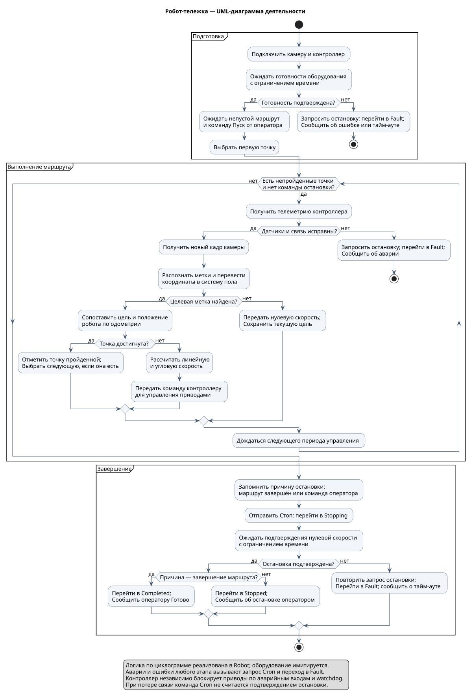
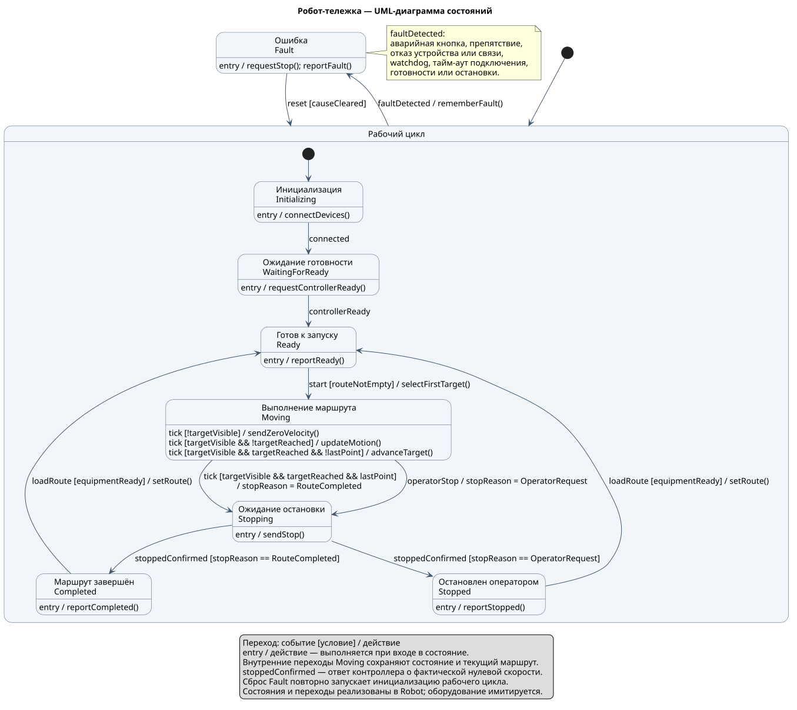

# UML-диаграммы робота

Модель по `Циклограмма.png`: инициализация, готовность, движение и подтверждение остановки. Эти состояния и переходы реализованы в `Robot`. Обработка изображений и физические устройства остаются учебной имитацией.

## Диаграмма деятельности



[Исходник PlantUML](uml/robot-activity.puml) · [PNG](uml/robot-activity.png) · [SVG](uml/robot-activity.svg)

Пуск принимается с непустым маршрутом. Пустой маршрут не приводит к движению. Каждый повтор проверки готовности и остановки означает новый опрос устройства, а не активное ожидание в бесконечном цикле.

Аварийная кнопка, отказ связи и ошибки оборудования обрабатываются во всех активных этапах: контроллер блокирует приводы, программа запрашивает нулевую скорость и переходит в `Fault`. При недоступной связи отправленная команда сама по себе не доказывает остановку; watchdog контроллера действует независимо от Raspberry Pi.

## Диаграмма состояний



[Исходник PlantUML](uml/robot-state-machine.puml) · [PNG](uml/robot-state-machine.png) · [SVG](uml/robot-state-machine.svg)

`Moving` означает выполнение маршрута: робот может временно стоять при потере метки. `Stopping` означает, что команда отправлена, но физическая остановка ещё не подтверждена. Причина хранится в `StopReason`: `None`, `RouteCompleted` или `OperatorRequest`.

## Ответственность классов

| Часть модели | Класс или данные |
| --- | --- |
| Состояние и переходы | `Robot`, `RobotState` |
| Текущая цель и порядок точек | `Route` |
| Кадр и координаты меток | `Camera`, `Frame`, `VisionSystem` |
| Достижение точки и команда скорости | `MotionPlanner` |
| Готовность, одометрия и подтверждение остановки | `DriveController`, `Telemetry` |
| Периодические вызовы | `TaskScheduler` |

## Соответствие коду

| Элемент UML | Реализация |
| --- | --- |
| Вход в `Initializing`: подключение | Первый `update()` вызывает `Camera::connect()` и `DriveController::connect()` |
| `connected` | Камера и контроллер подтвердили подключение |
| Вход в `WaitingForReady` | `DriveController::requestReady()` |
| `controllerReady` | Телеметрия подтверждает готовность и остановку |
| `loadRoute`, `start` | Отдельные методы `Robot::loadRoute()` и `Robot::start()` |
| Внутренние переходы `Moving` | `Robot::updateMotion()` |
| Вход в `Stopping` | `beginStopping()` запоминает причину и отправляет Стоп |
| `stoppedConfirmed` | Новый ответ контроллера; приводит к `Completed` или `Stopped` |
| `faultDetected` | Проверка аварий, связи, исключений устройств и тайм-аутов в `update()` |
| `reset [causeCleared]` | `Robot::resetFault()`: проверка условий, очистка маршрута и повторная инициализация |
| Сообщения о готовности, завершении и ошибке | `Robot::status()`, читаемый основным потоком |

Тайм-аут подключения, готовности и остановки — по 2 секунды. Состояния `Ready`, `Completed` и `Stopped` ждут действий оператора. Подтверждение остановки относится к фактической скорости, а не к отправленной команде. Операции UML — краткие обозначения действий; отдельный класс на каждый переход не вводится.

## Нотация и повторное построение

Диаграмма деятельности использует начальный и конечный узлы, действия, условия и циклы. Диаграмма состояний использует составное состояние, внутренние переходы, действия входа и подписи переходов `событие [условие] / действие`.

Для локального построения нужны Java, PlantUML и Graphviz. Из корня проекта:

```sh
java -jar /path/to/plantuml.jar -charset UTF-8 -tsvg docs/uml/*.puml
java -jar /path/to/plantuml.jar -charset UTF-8 -tpng docs/uml/*.puml
```

Синтаксис проверялся по документации PlantUML: [диаграммы деятельности](https://plantuml.com/activity-diagram-beta) и [диаграммы состояний](https://plantuml.com/state-diagram).
